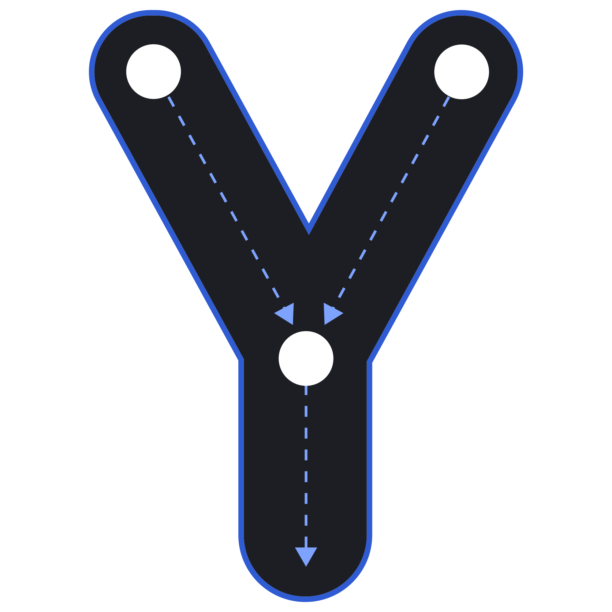
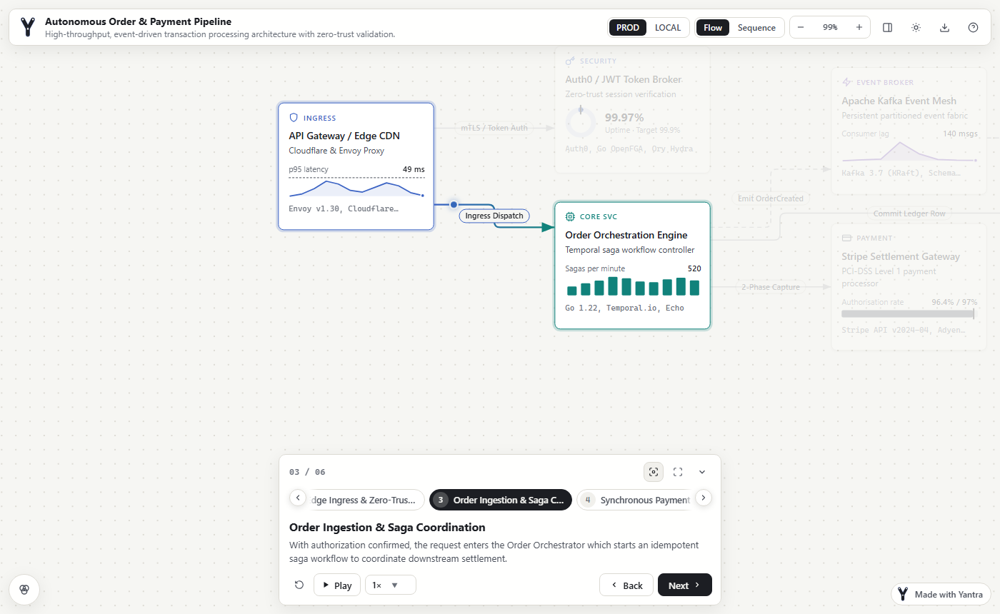
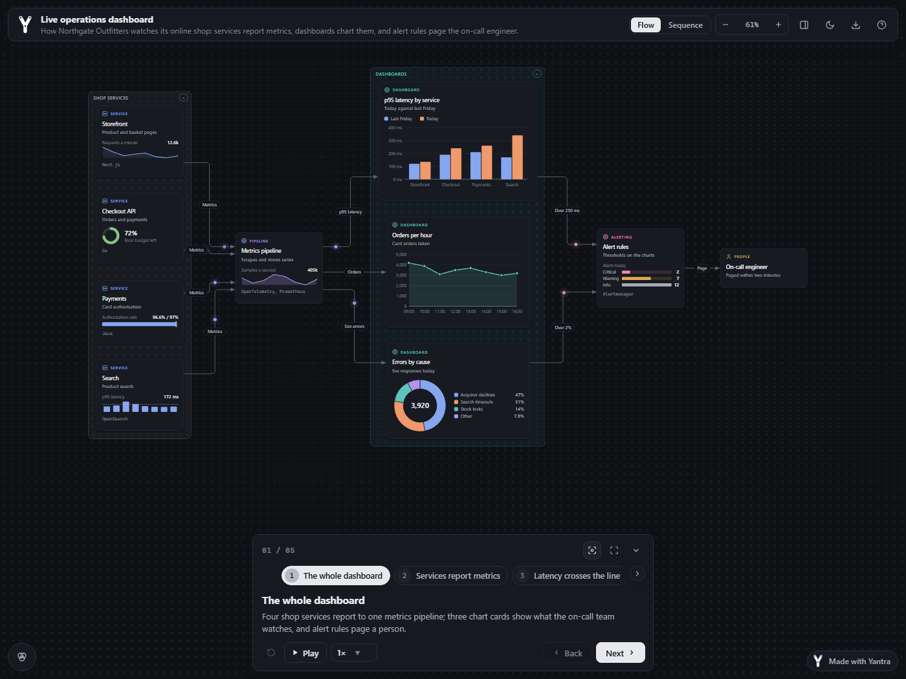
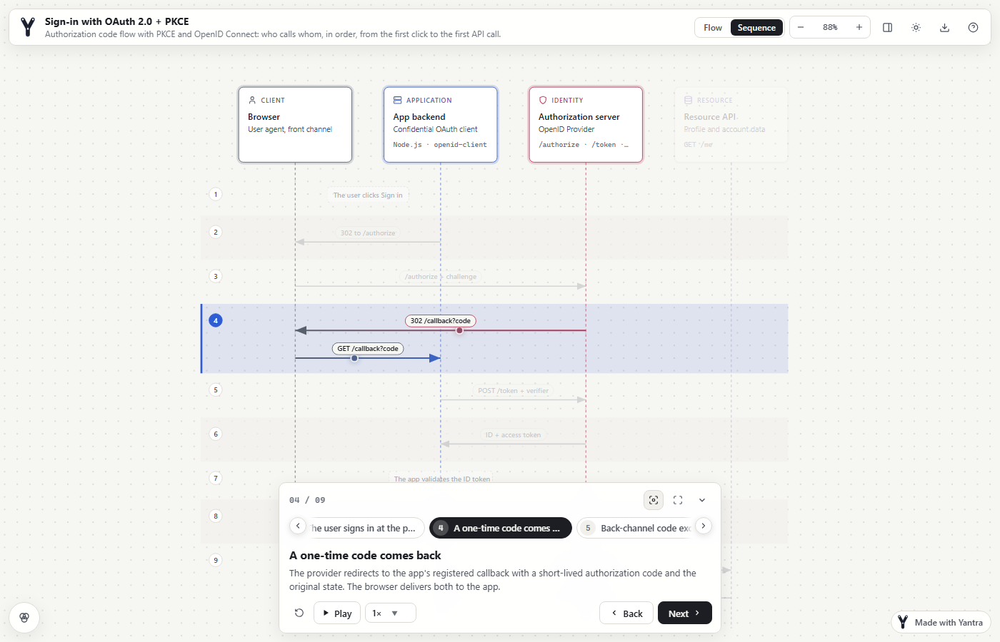
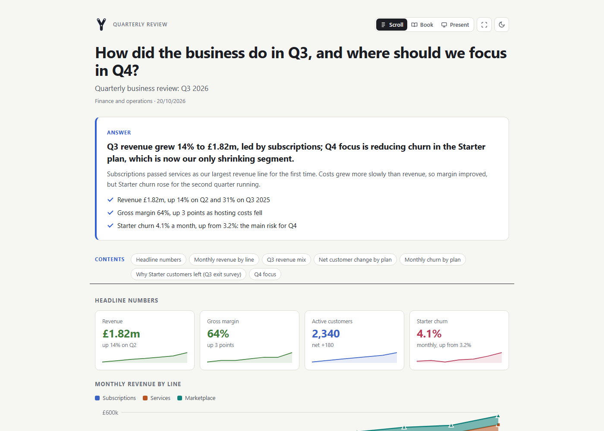

<p align="center">
  <picture>
    <source media="(prefers-color-scheme: dark)" srcset="src/assets/logo-dark.svg">
    
  </picture>
</p>

<h1 align="center">Yantra</h1>

<p align="center">
  Interactive, step-by-step diagrams and one-page answers, shipped as one offline HTML file.
</p>

<p align="center">
  <a href="https://github.com/niyankhadka/yantra/actions/workflows/ci.yml"></a>
  <a href="LICENSE"></a>
  
  <a href="https://www.npmjs.com/package/@niyankhadka/yantra"></a>
  <a href="https://pypi.org/project/niyankhadka-yantra/"></a>
</p>

Describe the parts of a system or process, how they connect and the story you want to tell,
in JSON (or start from a Mermaid, PlantUML, draw.io or Visio sketch). Yantra lays it out,
routes the edges, checks the rendered geometry and writes a single HTML file that works
offline, with a walkthrough readers can step through.

It is for engineers, analysts and teams who explain systems and decisions: architecture
reviews, request flows, incident reviews, onboarding, runbooks, data models, plans and
reports. You never place a card by hand, a validator catches overlaps and broken references
before anyone sees them, and the output is one file you can email, attach to a ticket or
open from a USB stick. The CLI, an MCP server, an agent skill and a Python SDK make it easy
to generate diagrams from scripts and coding agents.

<p align="center">
  
</p>

<table>
  <tr>
    <td width="50%"></td>
    <td width="50%"></td>
  </tr>
  <tr>
    <td align="center">Chart cards and mini charts, dark theme</td>
    <td align="center">The same payload as a sequence diagram</td>
  </tr>
</table>

## Contents

- [Features](#features)
- [Quick start](#quick-start)
- [Use in your project](#use-in-your-project)
- [Pick your output](#pick-your-output)
- [A diagram in 20 lines](#a-diagram-in-20-lines)
- [Diagram kinds](#diagram-kinds)
- [Answer pages and charts](#answer-pages-and-charts)
- [Import](#import)
- [CLI](#cli)
- [MCP server](#mcp-server)
- [Python SDK](#python-sdk)
- [Viewer keyboard shortcuts](#viewer-keyboard-shortcuts)
- [Languages](#languages)
- [Examples gallery](#examples-gallery)
- [Project layout](#project-layout)
- [Development](#development)
- [Contributing, support and security](#contributing-support-and-security)
- [Support the project](#support-the-project)

## Features

**Diagrams and layouts**
- Automatic layered layout with orthogonal edge routing: edges avoid cards, spread their
  ports and carry their labels. No coordinates to write (a manual layout is available).
- Groups (VPC, team, phase) nested up to six levels in one frame, with titles that never
  collide and edges that cross borders cleanly.
- Trees, org charts, decision trees and mind maps; state machines with fork / join and
  concurrent regions; ER and UML class diagrams with crow's foot and UML end markers.
- A sequence (lifeline) view of the same payload, and modes (for example production against
  local) that hide nodes or swap details.

**Walkthroughs and navigation**
- Scenarios with steps that focus cards and animate the active path; autoplay, camera follow
  and a full-screen present mode.
- Folding for big diagrams: fold a subtree or group into one card, fold to a depth, or zoom
  to a group with a breadcrumb of the boxes around it.
- Drill-down: overview cards open detail diagrams, up to eight levels, with Back, `Esc` and
  deep links.
- An inspector with Summary, Step and Details tabs plus custom panels; links on cards, edges
  and steps (http, https and mailto only).

**Answer pages and charts**
- Answer pages (`"kind": "page"`) put the conclusion first, then blocks: points, steps,
  metrics, charts, compare, table, timeline, FAQ, checklist, gantt, matrix, code, sources and
  embedded diagrams (static, or up to two live viewers per page).
- Bar, column, line, area, pie and donut charts, sparklines, gantt plans and 2x2 or risk
  heat-map matrices, drawn as inline SVG with no chart library.
- Charts inside diagrams: a mini chart on any card, or a chart card that connects like any
  other card.

**Import**
- Mermaid, PlantUML, draw.io / diagrams.net (including PNG exports with the diagram embedded)
  and Visio `.vsdx`. Every import is validated straight away.

**Output and sharing**
- A single offline HTML file that makes no external requests; also SVG, PNG and Markdown.
- View state lives in the URL hash, so a link reopens the same step, mode, level and theme.
- Light and dark themes, a print stylesheet, and your own logo (see [Branding](#branding)).

**Languages and accessibility**
- 18 interface languages, right-to-left layout for Arabic, Hebrew, Persian and Urdu, and
  locale number formats.
- Full keyboard control, a shortcuts panel, hidden data tables for charts, and WCAG contrast
  tests on the theme tokens.

**Validation and tooling for agents**
- A validator with stable codes for schema, references, story and rendered geometry
  (overlaps, edges through cards, label collisions) in every mode and view.
- CLI, MCP server, an agent skill for coding agents, and a Python SDK.

## Quick start

Yantra needs **Node.js 20.19 or later** (22.12 or later on Node 22).

```bash
npm i -g @niyankhadka/yantra      # the `yantra` command; ships a prebuilt viewer
yantra new diagram.json           # starter diagram (--page for an answer page)
yantra validate diagram.json      # schema, references, story, geometry
yantra build diagram.json         # -> diagram.html (works offline)
yantra screenshot diagram.json    # -> diagram-light.png (uses local Chrome or Edge)
```

Without installing: `npx @niyankhadka/yantra build diagram.json`. The Python SDK is
`pip install niyankhadka-yantra` (import `yantra`).

To work on Yantra or browse every example in the viewer, run it from a clone:

```bash
git clone https://github.com/niyankhadka/yantra.git
cd yantra
npm install
npm run dev                       # viewer with every example at http://localhost:3000
```

## Use in your project

One command sets up your coding agent to make Yantra diagrams in your own repository:

```bash
npx @niyankhadka/yantra init          # agents whose folders exist here, else Claude Code
npx @niyankhadka/yantra init --all    # Claude Code, Cursor, Codex and Antigravity
```

| Agent | Files `init` writes | Use it |
|---|---|---|
| Claude Code (`--claude`) | `.claude/skills/yantra/SKILL.md`, `yantra` server in `.mcp.json` | `/yantra`, or ask for a diagram |
| Cursor (`--cursor`) | `.cursor/rules/yantra.mdc`, `yantra` server in `.cursor/mcp.json` (the skill comes from `.claude/skills` or `.agents/skills`, else `.cursor/skills`) | `/yantra`, or ask for a diagram |
| Codex (`--codex`) | `.agents/skills/yantra/SKILL.md`, a Yantra section in `AGENTS.md`, `yantra` server in `.codex/config.toml` | `$yantra`, or ask for a diagram |
| Antigravity (`--antigravity`) | `.agents/skills/yantra/SKILL.md`, `.agents/rules/yantra.md`, `yantra` server in `.agents/mcp_config.json` | ask for a diagram |

The skill's description lists what it is for (diagram, visualise, architecture, flow,
sequence, ERD, state machine, org chart, mind map, explainer, step by step, one-page answer,
Mermaid, PlantUML and draw.io import), so agents pick it up without being told. It reads the
code before drawing (routes, services, schema, migrations), uses a sequence diagram for auth
and payment flows, an ERD for the schema, an overview with drill-down for big systems, and
keeps sources and HTML in `docs/diagrams/`.

`init` writes only inside the project (`--dir path` picks another folder), never overwrites a
file it did not write (`--force` replaces the Yantra parts), merges MCP configs so other
servers stay, and is safe to run again. `--dry-run` shows what it would do. The MCP server runs
through `npx -y @niyankhadka/yantra mcp`; on Windows `init` writes `cmd /c npx ...`, because
agents cannot start the `npx` shim directly there (`--posix` or `--windows` picks the form,
for a team that shares the file across systems). Manual setup for every agent and Claude
Desktop: [`docs/agents.md`](docs/agents.md).

## Pick your output

| The question | Output | Start from |
|---|---|---|
| How do the parts connect, how does the flow run? | Diagram (flow view) | `yantra new x.json`, [`cloud-architecture`](examples/cloud-architecture.json) |
| Who calls whom, in what order? | Diagram with `meta.view: "sequence"` | [`oauth-login`](examples/oauth-login.json) |
| What states can it be in, and what moves it? | Diagram with `shape: "state"` | [`ticket-lifecycle`](examples/ticket-lifecycle.json) |
| What tables or classes exist and how do they relate? | Diagram with `fields` / `methods` | [`ecommerce-schema`](examples/ecommerce-schema.json), [`payment-classes`](examples/payment-classes.json) |
| Who reports to whom, how does it break down? | Diagram with `meta.layout.algorithm: "tree"` or `"mindmap"` | [`org-chart`](examples/org-chart.json), [`study-plan-mindmap`](examples/study-plan-mindmap.json) |
| What is the answer, which option, what happened? | Answer page (`"kind": "page"`) | `yantra new x.json --page`, [`answer-checkout-saga`](examples/answer-checkout-saga.json) |
| How are the numbers doing? | Answer page with charts | [`chart-sales-dashboard`](examples/chart-sales-dashboard.json) |
| I already have a Mermaid, PlantUML, draw.io or Visio sketch | `yantra import` | [`examples/mermaid/`](examples/mermaid), [`examples/plantuml/`](examples/plantuml), [`examples/drawio/`](examples/drawio), [`examples/visio/`](examples/visio) |

## A diagram in 20 lines

```json
{
  "meta": { "title": "Checkout", "description": "How an order is paid and stored." },
  "nodes": [
    { "id": "web", "type": "client", "data": { "title": "Web app", "subtitle": "Customer checkout" } },
    { "id": "api", "type": "service", "data": { "title": "Orders API", "tech": "Go" } },
    { "id": "db", "type": "data", "data": { "title": "Orders DB", "tech": "PostgreSQL", "icon": "database" } }
  ],
  "edges": [
    { "id": "web-api", "source": "web", "target": "api", "label": "POST /orders" },
    { "id": "api-db", "source": "api", "target": "db", "label": "INSERT order" }
  ],
  "steps": [
    { "title": "Overview" },
    { "title": "Submit", "highlightNodes": ["web", "api"], "highlightEdges": ["web-api"] },
    { "title": "Persist", "highlightNodes": ["api", "db"], "highlightEdges": ["api-db"] }
  ]
}
```

Save it as `checkout.json`, then `yantra validate checkout.json` and `yantra build checkout.json`.
Layout is automatic: there are no coordinates. Highlighted edges need both of their endpoints
highlighted. The full rules, budgets and validation codes are in
[`docs/authoring.md`](docs/authoring.md); the schema is
[`schemas/yantra-payload.schema.json`](schemas/yantra-payload.schema.json).

## Diagram kinds

| Kind | How | Example |
|---|---|---|
| Flow / architecture | Default layered layout; `groups` for boundaries | [`cloud-architecture`](examples/cloud-architecture.json), [`aws-serverless`](examples/aws-serverless.json) |
| Sequence | `meta.view: "sequence"` (or key `V`); one message per step | [`oauth-login`](examples/oauth-login.json) |
| State machine / lifecycle | `shape: "state"`, `"initial"`, `"final"`, `"choice"`; fork, join and regions | [`ticket-lifecycle`](examples/ticket-lifecycle.json), [`parallel-checkout-states`](examples/parallel-checkout-states.json) |
| ERD / class diagram | `fields` and `methods` rows; edge `relation`, `sourceEnd`, `targetEnd` | [`ecommerce-schema`](examples/ecommerce-schema.json), [`payment-classes`](examples/payment-classes.json) |
| Tree / org chart / decision tree | `meta.layout.algorithm: "tree"` (TB or LR) | [`org-chart`](examples/org-chart.json), [`incident-triage-decision-tree`](examples/incident-triage-decision-tree.json) |
| Mind map | `meta.layout.algorithm: "mindmap"` | [`study-plan-mindmap`](examples/study-plan-mindmap.json) |
| Deep nesting | Groups with `parent`, up to six levels; fold to depth, zoom to a group | [`smart-city-operations`](examples/smart-city-operations.json) |
| Drill-down | `data.drill` opens a level from the `diagrams` map or a `$ref` file | [`platform-overview`](examples/platform-overview.json), [`global-retail-group`](examples/global-retail-group.json) |
| Chart cards | `data.chart` (mini chart) or `"shape": "chart"` (chart card) | [`live-operations-dashboard`](examples/live-operations-dashboard.json) |

Details for each kind are in [`docs/authoring.md`](docs/authoring.md): for example
[groups](docs/authoring.md#groups), [deep hierarchies](docs/authoring.md#deep-hierarchies),
[drill-down](docs/authoring.md#drill-down-an-overview-plus-detail-diagrams) and
[charts in diagrams](docs/authoring.md#charts-in-diagrams).

## Answer pages and charts



An answer page answers one question on one printable page: the headline answer first, then
3 to 8 blocks of evidence. Use it for explainers, decisions, comparisons, how-tos, incident
reviews, plans and reports.

```json
{
  "kind": "page",
  "meta": { "question": "Why a saga?", "title": "Saga", "kicker": "Decision" },
  "answer": { "headline": "Because no single transaction spans the payment provider and our services." },
  "blocks": [{ "type": "points", "title": "Reasons", "items": [{ "title": "Separate systems" }] }]
}
```

- Blocks: `points`, `steps`, `metrics`, `chart`, `gantt`, `matrix`, `compare`, `table`,
  `diagram`, `callout`, `text`, `code`, `sources`, `timeline`, `faq`, `checklist`, `quote`,
  `image`, `kv`. `span: "half"` puts two blocks side by side.
- Charts: bar, column, line, area, pie and donut, with grouped or stacked series, legends that
  toggle series, a dashed `target` line and a hidden data table for screen readers.
- Plans: `gantt` with dates or relative days, working days and holidays, milestones,
  dependencies and a today line. `matrix` draws 2x2 quadrants or 3x3 to 5x5 risk heat maps.
- A contents row appears on longer pages; `yantra export page.json -f md` gives a Markdown copy.

Rules and every block's fields: [`docs/pages.md`](docs/pages.md). Schema:
[`schemas/yantra-page.schema.json`](schemas/yantra-page.schema.json).

## Import

```bash
yantra import flow.mmd                    # -> flow.json, then validated
yantra import model.drawio --page 2       # one page of a multi-page file
yantra import notes.md --all              # every ```mermaid block -> notes-1.json, notes-2.json...
```

| Source | Becomes a diagram | Becomes an answer page | Guide |
|---|---|---|---|
| Mermaid (`.mmd`, ```` ```mermaid ```` in `.md`) | flowchart, sequence, state, ER, class, mind map, journey | gantt, pie, timeline, quadrant chart | [`docs/mermaid.md`](docs/mermaid.md) |
| PlantUML (`.puml`, ```` ```plantuml ```` in `.md`) | sequence, component, deployment, use case, activity, state, class, object, ER, mind map, WBS | Gantt | [`docs/import.md`](docs/import.md#plantuml) |
| draw.io / diagrams.net (`.drawio`, `.xml`, `.drawio.svg`, `.drawio.png`) | shapes, colours, icons, containers and swimlanes as groups, edge labels, ER and UML ends | | [`docs/import.md`](docs/import.md#drawio--diagramsnet) |
| Visio (`.vsdx`) | shapes, glued connectors, groups | | [`docs/import.md`](docs/import.md#visio-vsdx) |

The format is detected from the extension or the content; `--from mermaid|drawio|plantuml|visio`
forces it. Importers keep up to six levels of nested groups.

## CLI

| Command | What it does |
|---|---|
| `yantra validate <file.json> [--json] [--lang xx]` | Check schema, references, story and rendered geometry. Exits with code 1 on errors. |
| `yantra build <file.json> [-o out.html] [--force]` | Validate, then write a single offline HTML file. |
| `yantra export <file.json> -f svg\|md [-o file]` | Static SVG (diagrams) or Markdown (diagrams and pages). |
| `yantra screenshot <file.json\|page.html> [-o out.png]` | PNG through the local Chrome or Edge (`YANTRA_BROWSER` overrides). |
| `yantra new <file.json> [--page]` | Write a starter diagram or answer page. |
| `yantra import <file> [-o out.json]` | Convert Mermaid, PlantUML, draw.io or Visio, then validate. |
| `yantra examples [name] [-o file]` | List the built-in examples, or copy one. |
| `yantra init [--claude] [--cursor] [--codex] [--antigravity] [--all]` | Set up a project for coding agents: skill, MCP server, rules ([Use in your project](#use-in-your-project)). `[--dir path] [--force] [--dry-run] [--json] [--windows\|--posix]` |
| `yantra schema [diagram\|page]` | Print the JSON Schema for diagrams or answer pages. |
| `yantra docs [authoring\|pages\|mermaid\|import\|agents]` | Print a guide. |
| `yantra mcp` | Start the MCP server on stdio. |
| `yantra dev` | Start the live viewer at http://localhost:3000 (from a clone after `npm install`, or with `vite` installed next to the package). |

<details>
<summary>All options</summary>

| Option | Commands | Meaning |
|---|---|---|
| `--json` | validate | Machine-readable output. |
| `--lang xx` | validate | Messages in a built-in language (`es`, `ja`, `ar`...); `auto` uses `meta.lang`. Codes stay the same. |
| `--force` | build | Build even when validation reports errors. |
| `--theme light\|dark` | export, screenshot | Theme to draw. |
| `--mode id` | export | One of the diagram's modes. |
| `--view flow\|sequence` | export, screenshot | Flow graph or sequence diagram. |
| `--step n` | export, screenshot | Highlight walkthrough step `n` (1-based). |
| `--level id` | export, screenshot | A detail diagram (drill-down level) instead of the overview. |
| `--all-levels` | export (`-f md`) | Append every detail diagram after the overview. |
| `--collapsed a,b` | build, export, screenshot | Open with these subtrees or groups folded, instead of `meta.layout.collapsed`. |
| `--expand-all` | build, export, screenshot | Open with nothing folded. |
| `--depth n` | build, export, screenshot | Fold to depth `n`: `n` levels of boxes or tree levels stay open. |
| `--focus group` | screenshot | Zoom the camera to a group, unfolding it and the boxes around it. |
| `--width`, `--height` | screenshot | Viewport size; `--width 390` shows a page at phone width. |
| `--from mermaid\|drawio\|plantuml\|visio` | import | Force the source format. |
| `--page n\|name` | import | draw.io or Visio page to import (default: the first). |
| `--title "..."` | import | Title of the imported diagram. |
| `--all` | import | Import every page or diagram block. |

</details>

From a clone without `npm link`, use `node bin/yantra.js` in place of `yantra`.

## MCP server

The MCP server (`node mcp/server.js`, or `yantra mcp`) speaks MCP over stdio. This
repository registers it in [`.mcp.json`](.mcp.json) and
[`.agents/mcp_config.json`](.agents/mcp_config.json); for another MCP client, add:

```json
{
  "mcpServers": {
    "yantra": { "command": "node", "args": ["/path/to/yantra/mcp/server.js"] }
  }
}
```

| Tool | Purpose |
|---|---|
| `yantra_get_schema` | JSON Schemas and authoring rules (`kind`: `diagram` or `page`). |
| `yantra_list_examples` / `yantra_get_example` | Built-in examples to use as references. |
| `yantra_validate` | Errors and warnings with stable codes; `lang` translates the messages. |
| `yantra_build` | Validate and write a single offline HTML file. |
| `yantra_export` | SVG or Markdown, written to a file or returned. |
| `yantra_import` | Mermaid, PlantUML, draw.io or Visio to a payload, then validate. |
| `yantra_import_mermaid` | Mermaid text to a payload. |
| `yantra_screenshot` | PNG of a diagram or page for visual review. |

File access is sandboxed: tools read `filePath` only inside `YANTRA_INPUT_ROOT` and write
`outputPath` only inside `YANTRA_OUTPUT_ROOT` (both default to the server's working
directory), with fixed extensions.

**Agent skill.** `yantra init` installs the portable skill
([`skills/yantra/SKILL.md`](skills/yantra/SKILL.md)) and this server in your project; see
[Use in your project](#use-in-your-project) and [`docs/agents.md`](docs/agents.md). The skill
for working on Yantra itself is [`.claude/skills/yantra/SKILL.md`](.claude/skills/yantra/SKILL.md),
with an identical copy in [`.agents/skills/yantra/SKILL.md`](.agents/skills/yantra/SKILL.md) and
repository guidance in [`AGENTS.md`](AGENTS.md). Architecture notes: [`docs/architecture.md`](docs/architecture.md).

## Python SDK

The SDK (Python 3.9 or later, no third-party dependencies) writes payloads in Python and calls
the CLI to validate and build, so Node.js is still needed for those steps.

```bash
pip install niyankhadka-yantra    # or `pip install -e python/` from a clone
```

```python
from yantra import Diagram

d = Diagram("Checkout", "How an order is paid and stored.")
web = d.add_node("web", "Web app", "client", subtitle="Customer checkout")
api = d.add_node("api", "Orders API", "service", tech="Go")
db = d.add_node("db", "Orders DB", "data", tech="PostgreSQL")
web.connect(api, "POST /orders")
api.connect(db, "INSERT order")
d.add_step("Overview")
d.add_step("Submit", nodes=[web, api])
d.add_step("Persist", nodes=[api, db])

print(d.validate())             # {'valid': True, 'errors': [], 'warnings': []}
d.build_html("checkout.html")
```

Pages (`from yantra import Page`), trees, data models, charts, deep hierarchies and import are
covered in [`python/README.md`](python/README.md).

## Viewer keyboard shortcuts

Press `?` (or the toolbar's help button) to open the shortcuts panel. It lists only the keys
that do something in the open diagram, and each toolbar button's tooltip shows its key.

| Key | Action | Key | Action |
|---|---|---|---|
| `→` / `Space`, `←` | Next / previous step | `Home` / `End` | First / last step |
| `P` | Play / pause | `C` | Camera follows steps |
| `S` | Collapse the walkthrough | `1`-`9` | Switch scenario |
| `V` | Flow / sequence view | `M` | Next mode |
| `I` | Inspector | `L` | Roles legend |
| `T` | Light / dark | `F` | Full screen |
| `X` | Fold / unfold the selected branch | `1`-`6`, `0` | Fold to depth, open everything (`Shift` with several scenarios) |
| `D` | Open the card's detail diagram | `G` | Zoom to the selected card's group |
| `+` / `-`, `R` | Zoom, fit to screen | `Esc` | Clear selection, then back up a level |

Drag a card to move it (edges re-route live), drag the background to pan, and double-click a
group title to zoom to it. **Export → Copy JSON with positions** saves an arrangement as a
manual layout.

<details>
<summary>Links that reopen a view</summary>

The view state is mirrored in the URL hash, for example
`#level=payments&step=3&mode=dev&view=sequence&scenario=2&collapsed=a,b&depth=2&focus=<group>&theme=dark`.
The dev server also takes `#example=<name>`. Printing switches to the light theme and hides
the controls.

</details>

## Languages

Set `meta.lang` (a BCP 47 tag) on a diagram or page and the viewer controls, page labels,
badge and exports switch language; numbers use that language's format. 18 languages are built
in: English, Spanish, French, German, Portuguese, Italian, Hindi, Bengali, Nepali, Chinese
(Simplified and Traditional), Japanese, Korean, Indonesian, Arabic, Hebrew, Persian and Urdu.
Arabic, Hebrew, Persian and Urdu (or `meta.dir: "rtl"`) mirror the interface. Other languages
keep English labels, and `meta.strings` overrides any label. See
[Languages and right to left](docs/authoring.md#languages-and-right-to-left).

## Examples gallery

[`examples/`](examples) holds 25 diagrams, 13 answer pages and 7 chart pages, plus import
samples for Mermaid, PlantUML, draw.io and Visio. Every example validates with no warnings.
Run `npm run dev` and pick one from the example menu, which has three sections:

| Section | Count | Includes |
|---|---|---|
| Diagrams | 25 | cloud architecture, chart cards, sequence, ERD, UML, drill-down, six-level nesting, states, trees, mind map, Nepali and Arabic |
| Answer pages (Q&A) | 11 | decisions, incident reviews, explainers, a how-to, a kickoff and an Arabic page |
| Charts & dashboards | 9 | sales, marketing, budget, survey, portfolio, service levels, headcount, quarterly review, launch plan |

`yantra examples` lists them all and `yantra examples oauth-login -o oauth.json` copies one.
Companies and data in the examples are fictional.

## Branding

Put your logo in `src/assets/`: `logo-light.svg` (a dark mark for the light theme) and
`logo-dark.svg` (a light mark for the dark theme). They replace the default mark in the
toolbar, the badge and the tab icon, and are embedded in built HTML, SVG exports and answer
pages. Use a square `viewBox` without a fixed `width` or `height`. `meta.watermark: false`
hides the "Made with Yantra" badge; a string renames it.

The badge links back to this repository. It's optional, but keeping it is a simple way to
support the project and help others find it.

## Project layout

```
bin/yantra.js        CLI
mcp/server.js        MCP server (stdio)
lib/                 Node only: standalone HTML builder, headless screenshots, yantra init
skills/yantra/       Portable agent skill that yantra init installs in other projects
src/core/            Shared engine: model, layout, routing, lint, pages, charts, importers, i18n
src/app/             Browser viewer
src/styles/          Viewer CSS
src/assets/          Logos
schemas/             JSON Schemas for diagrams and answer pages
examples/            Example diagrams and pages, and import samples
docs/                Authoring, pages, import, agent setup and architecture guides
python/              Python SDK (niyankhadka-yantra)
tests/               Node test suite
```

## Development

```bash
npm install
npm test                                          # Node suite (node --test)
npm run build                                     # viewer bundle into dist/
pip install -e python/
python -m unittest discover -s python/tests -v    # Python SDK
```

CI ([`.github/workflows/ci.yml`](.github/workflows/ci.yml)) runs the tests on Node 20, 22
and 24 on Linux and Node 24 on Windows, validates and builds every example, and runs the
Python SDK tests on Python 3.9 and 3.12. Geometry logic lives only in `src/core/`; the
viewer, CLI and MCP server all call it.

## Contributing, support and security

- [Contributing guide](CONTRIBUTING.md): setup, tests and the rules they enforce.
- [Support](SUPPORT.md): where to ask questions and report bugs.
- [Code of conduct](CODE_OF_CONDUCT.md).
- [Security policy](SECURITY.md): report vulnerabilities privately.
- [Changelog](CHANGELOG.md): what changed in each release.

## Support the project

If Yantra is useful to you, you can [buy me a coffee](https://buymeacoffee.com/niyankhadka),
star the repository, or keep the "Made with Yantra" badge in your diagrams.

## Licence

[MIT](LICENSE) © niyankhadka. The licence covers the code; the Yantra name and logo are
covered by the [trademark policy](TRADEMARKS.md).
